# Agentforce banking reference implementation

A reference implementation that an SI partner can copy while building a backlog of 30+ Agentforce agents for an
investment bank's bankers. It ships two capabilities on one pattern:
- **Client Meeting Summary:** after a meeting, the banker clicks a button or asks the Banker Assistant agent, and gets a
  structured, validated summary saved on the meeting record and as a PDF.
- **Meeting Prep Q&A:** the banker asks a question about a client and gets a short answer in which every sentence cites
  CRM records or research notes.

Everything runs on Salesforce: Apex, Prompt Builder (Flex templates on GPT 5.4) and an employee agent built in Agent
Builder. It was built as a take-home for a Partner Technical Architect (Agentforce) panel interview.

## Design rule

**The LLM writes. Code gathers the facts and checks the output.**
- Client facts come from deterministic Apex queries run in user mode, never from the model's memory.
- Templates return strict JSON. Apex validates it, retries once (a plain resample of the same frozen template), and
  otherwise replaces it with a deterministic, clearly labelled fallback. A banker never sees invented or broken content.
- Every generation writes one `AI_Generation_Log__c` row.
- One service class serves both the button and the agent.

## Architecture

```mermaid
flowchart TB
    subgraph Entry["Entry points (run as the banker)"]
        BTN["Generate Summary button<br/>(quick action on Client_Meeting__c)"]
        AGENT["Banker Assistant agent v5<br/>(employee agent, Lightning panel)"]
    end

    BTN --> FLOW["Screen Flow<br/>Generate_Client_Meeting_Summary"]
    FLOW --> CSS

    AGENT --> FCM["Find Client Meetings<br/>FindClientMeetingsAction"]
    AGENT --> FC["Find Client<br/>FindClientAction"]
    FCM -->|"sets selected_meeting_id<br/>(empty unless exactly one match)"| GM{{"guard: available when<br/>selected_meeting_id is not empty"}}
    FC -->|"sets selected_account_id<br/>(empty unless exactly one match)"| GA{{"guard: available when<br/>selected_account_id is not empty"}}
    GM -->|"bound input, cleared after use"| CSS["Generate Client Meeting Summary<br/>ClientSummaryService"]
    GA -->|"bound input, cleared after use"| MPS["Answer Client Question<br/>MeetingPrepService"]

    subgraph Pattern["Context → Template → Validate → Fallback → Log"]
        CTX["1. Context<br/>ClientContextBuilder (USER_MODE,<br/>source ids, budget, untrusted notes)"]
        TPL["2. Template via ILlmGateway<br/>PromptTemplateGateway"]
        VAL["3. Validate<br/>SummaryValidator / CitationValidator"]
        FB["4. Fallback<br/>data-only summary / message-only answer"]
        LOG["5. Log<br/>AiActionSupport.logRow"]
        CTX --> TPL --> VAL
        VAL -->|"invalid: one plain retry, then"| FB
        VAL --> LOG
        FB --> LOG
    end

    CSS --> CTX
    MPS --> CTX

    subgraph PB["Prompt Builder (Flex, GPT 5.4)"]
        T1["Client_Meeting_Summary _5<br/>grounded by ClientContextBuilder"]
        T2["Meeting_Prep_QA _2<br/>grounded by AccountContextAction"]
    end
    TPL --> T1
    TPL --> T2

    CSS --> REC["Client_Meeting__c fields<br/>+ PDF (ContentVersion)"]
    LOG --> LOGOBJ[("AI_Generation_Log__c<br/>Private, AI_Ops + admins")]
```



Both services return banker-facing outputs: Status, the summary or answer, Review Items, a Message, and plain "Open X:
https://..." link lines built in Apex. The agent is told to show them verbatim. It doesn't always do so; see the known
limitations in [FUNCTIONAL_SPEC_NOTES](docs/FUNCTIONAL_SPEC_NOTES.md).

## Repo map

| Path | What it holds |
| --- | --- |
| `force-app/main/default/classes/` | Apex. Services: `ClientSummaryService`, `MeetingPrepService`. Context: `ClientContextBuilder`, `AccountContextAction`. Validators: `SummaryValidator`, `CitationValidator`. Rendering: `SummaryRenderer`. Agent actions: `FindClientMeetingsAction`, `FindClientAction`. Shared: `AiActionSupport`. LLM seam: `ILlmGateway`, `PromptTemplateGateway`, `LlmResponse`. Test kit: `MockLlmGateway`, `SummaryTestData`, and a `*Test` class for each class |
| `force-app/main/default/objects/` | `Client_Meeting__c`, `Research_Note__c`, `AI_Generation_Log__c` (created in Setup, then retrieved) |
| `force-app/main/default/genAiPromptTemplates/` | `Client_Meeting_Summary` (active `_5`), `Meeting_Prep_QA` (active `_2`) |
| `force-app/main/default/aiAuthoringBundles/Banker_Assistant/` | The agent (Agent Script), version v5 |
| `force-app/main/default/flows/`, `quickActions/`, `layouts/` | The Generate Summary screen flow, the quick action and the Client Meeting layout |
| `force-app/main/default/permissionsets/` | `Banker_Summary` (bankers), `AI_Ops` (log readers) |
| `force-app/main/default/cspTrustedSites/` | Trusted URLs for this org's Lightning and My Domain hosts |
| `force-app/main/default/standardValueSets/` | Opportunity Type with M&A, ECM, DCM |
| `scripts/apex/` | Seed data scripts (see "Seed data" below) |
| `docs/` | Specifications, logs, prompt history, test protocol and evidence (see "Documents" below) |
| `docs/prompt_outputs/` | Saved model outputs per prompt version, used for replays |
| `docs/snippets/` | Agent Script versions (`v5_final_script.txt` is the active one) |
| `specs/banker_assistant_tests.yaml` | Agent test cases (BA-01..BA-25) with every run's result and evidence |

## Deploy

These steps follow the order used in this build. A deploy from scratch into a new org has not been tested end to end.

1. **Org:** a Developer Edition (or sandbox) with Einstein, Agentforce and Prompt Builder enabled. Authenticate it:
   `sf org login web -a banking`.
2. **Opportunity Type values, objects, Apex, flow, quick action, layout:**
   ```
   sf project deploy start -o banking -m StandardValueSet:OpportunityType -m CustomObject -m ApexClass
   sf project deploy start -o banking -m Flow:Generate_Client_Meeting_Summary -m QuickAction -m Layout
   ```
3. **Prompt templates:** deploy `GenAiPromptTemplate`, or rebuild them in Prompt Builder from
   [PROMPT_ITERATIONS](docs/PROMPT_ITERATIONS.md). Make `_5` and `_2` the active versions; both use GPT 5.4.
4. **Agent:** deploy the `AiAuthoringBundle`, or create the Banker Assistant employee agent in Agent Builder and paste
   `docs/snippets/v5_final_script.txt` into the Script view. Activate it, then retrieve the bundle and diff it against
   the script: the UI doesn't show lines lost or removed (BUILD_LOG 2026-10-13).
5. **Trusted URLs:** the files in `cspTrustedSites/` name this build's org hosts. Change them to your org's Lightning host
   and the host `URL.getOrgDomainUrl()` returns, then deploy (`-m CspTrustedSite`). Without them, Agentforce shows links as
   `URL_Redacted`.
6. **Permission sets:** deploy `-m PermissionSet`. Then assign:
   - **Bankers:** `Banker_Summary` plus the standard **Prompt Template User** permission set. Without Prompt Template User,
     a banker gets a data-only summary and a message to ask the admin.
   - **AI Ops / admins who read logs:** `AI_Ops`. Bankers never get log access.

## Seed data

| Script | What it does |
| --- | --- |
| `scripts/apex/seed-data.apex` | Three fictional clients (Halverson, Northwind, Cobalt Ridge) with contacts, deals, activity, research notes and two meetings each, including the edge cases: empty notes, an injection line, a client with no open deals. **Do not re-run it in an org that has test history.** It deletes and recreates the three clients, which changes every meeting name (MTG-00xx), record Id and source id that the recorded replays and agent tests depend on |
| `scripts/apex/add-conflict-meeting.apex` | Insert-only. Adds MTG-0019: notes size Project Keel at ~$1.1bn vs CRM USD 850,000,000 |
| `scripts/apex/seed-data-2.apex` | Insert-only and idempotent. Adds the holdout client Meridian Health Partners (MTG-0020..0022), never used to write prompts or validators |

Run a script with `sf apex run -o banking -f scripts/apex/<script>.apex`.

## Tests

```
sf apex run test -o banking -l RunLocalTests -c -w 20
```

The tests never call the real LLM: `MockLlmGateway` stands in for the gateway. Last full run: 173/173, every class with
code at 90% or more, 97% org-wide (TC-01, [test evidence](docs/test_evidence/TC-01.md)). The full test protocol, including
the agent and holdout tests, is [TEST_PROTOCOL](docs/TEST_PROTOCOL.md); results are in
[test_results.csv](docs/test_results.csv).

## Documents

| Document | Purpose |
| --- | --- |
| [docs/Functional_Specification.docx](docs/Functional_Specification.docx) | The functional specification (generated by `scripts/docs/`) |
| [docs/Panel_Overview.pptx](docs/Panel_Overview.pptx) | 15-slide panel deck with speaker notes |
| [docs/Test_Protocol.docx](docs/Test_Protocol.docx) | The test protocol with results (generated from TEST_PROTOCOL.md and test_results.csv) |
| [CLAUDE.md](CLAUDE.md) | Build context and the detailed component rules |
| [docs/BUILD_PLAN.md](docs/BUILD_PLAN.md) | Day-by-day plan and status |
| [docs/FUNCTIONAL_SPEC_NOTES.md](docs/FUNCTIONAL_SPEC_NOTES.md) | Security, platform constraints, error handling, known limitations |
| [docs/PROMPT_ITERATIONS.md](docs/PROMPT_ITERATIONS.md) | Every prompt version with the change, the reason and the before/after output |
| [docs/summary_schema.json](docs/summary_schema.json), [docs/meeting_prep_schema.json](docs/meeting_prep_schema.json) | Output schemas for the two templates |
| [docs/BUILD_LOG.md](docs/BUILD_LOG.md) | Every problem hit: symptom, root cause, fix, lesson |
| [docs/AI_TOOLING_LOG.md](docs/AI_TOOLING_LOG.md) | Where the AI coding tool helped or misled, and how it was caught |
| [docs/SCALABILITY_RISKS.md](docs/SCALABILITY_RISKS.md) | Measured per-call cost, risk register, what to monitor |
| [docs/REUSABLE_PATTERN.md](docs/REUSABLE_PATTERN.md) | The pattern for the 30+ agent backlog: contracts, rules, test kit, checklist, anti-patterns |
| [docs/TEST_PROTOCOL.md](docs/TEST_PROTOCOL.md) | Pre-registered GxP-style test protocol |
| [docs/test_results.csv](docs/test_results.csv), [docs/test_evidence/](docs/test_evidence/README.md) | Test results and evidence |
| [specs/banker_assistant_tests.yaml](specs/banker_assistant_tests.yaml) | Agent test cases and run history |
